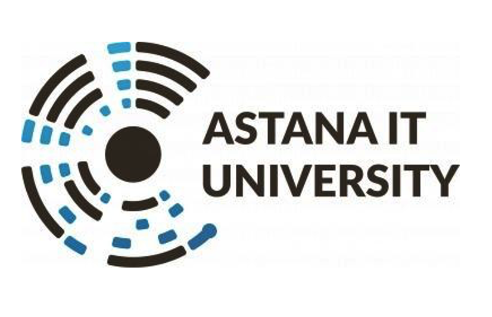
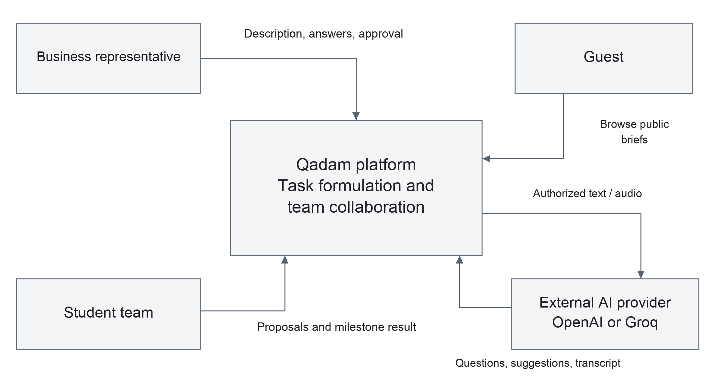
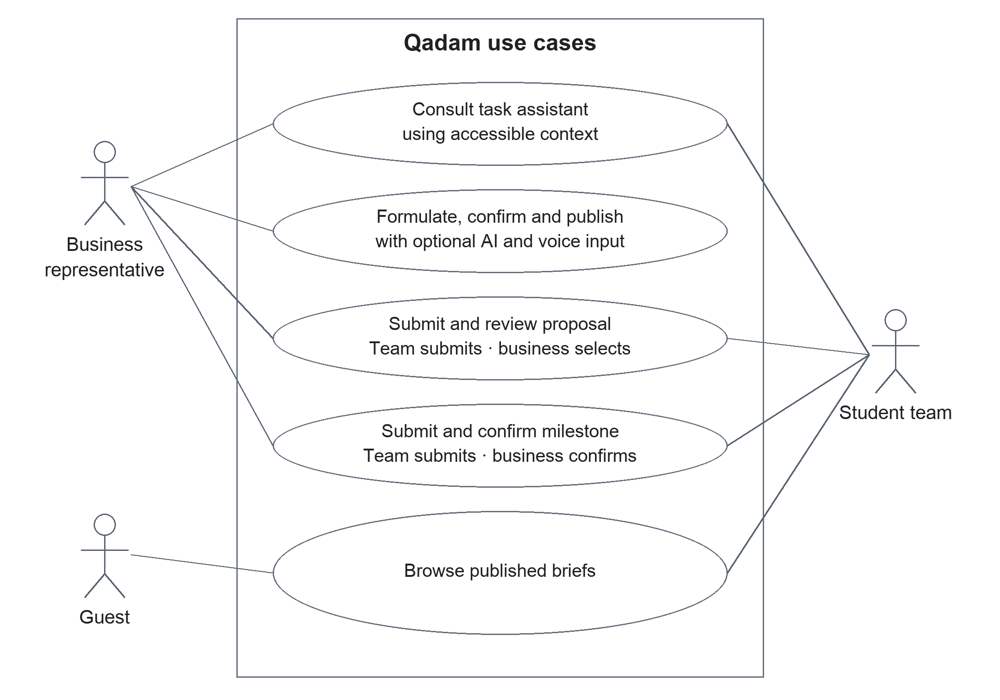
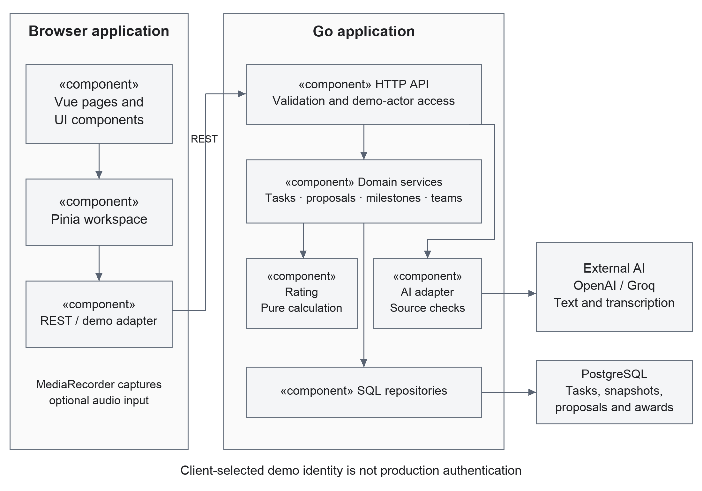
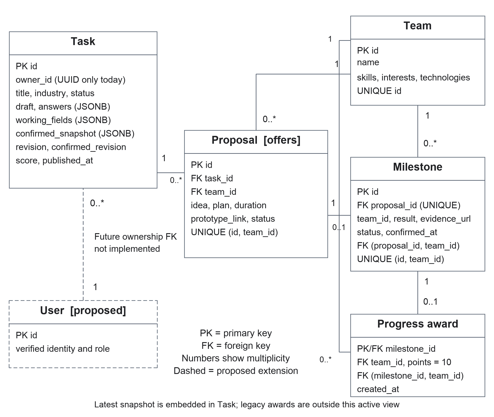
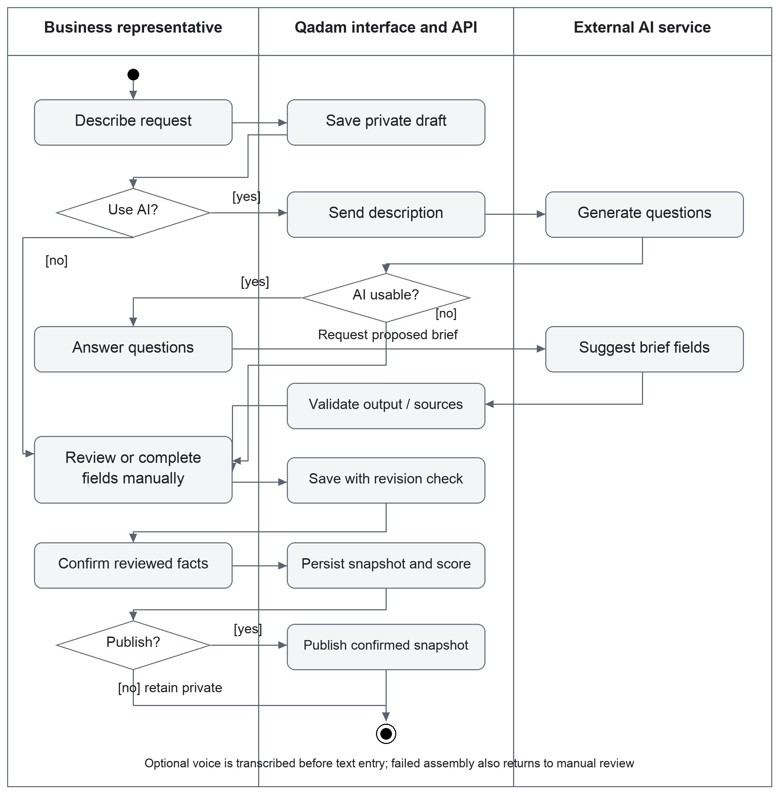
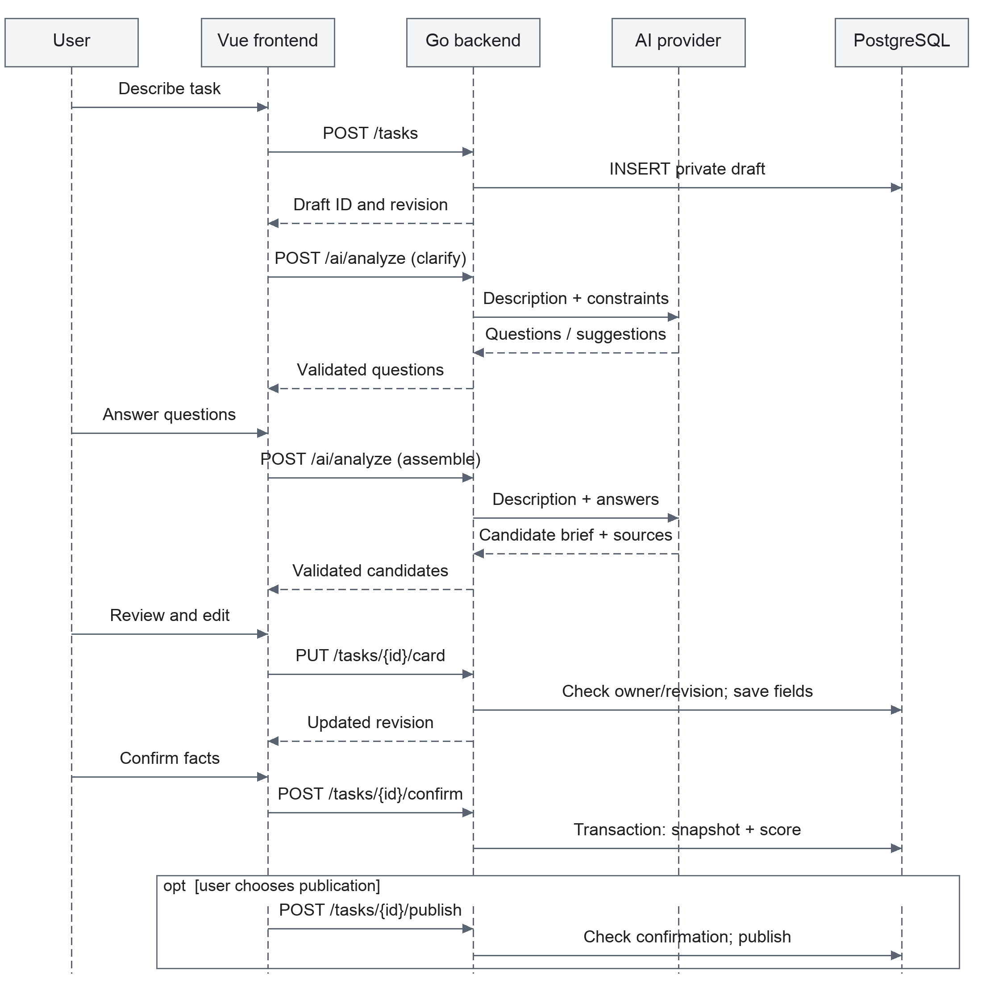
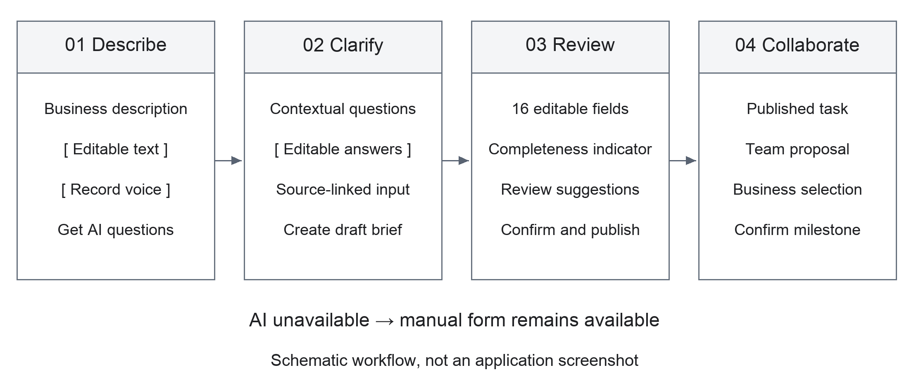

# Development of the Qadam Platform for Business Task Formulation Using Artificial Intelligence

Consolidated probationary period report

Team members

Bekasyl Zhaksylyk

Mereke Myrzakhan

Amantai Zere

Group: SE-2418

Supervisor — Altynbek Seitenov

Diploma repository — [https://github.com/bekasyl00/Qadam_Diplom](https://github.com/bekasyl00/Qadam_Diplom)

Submission version: [https://github.com/bekasyl00/Qadam_Diplom/tree/prob-period-1](https://github.com/bekasyl00/Qadam_Diplom/tree/prob-period-1)

This report presents Qadam, its architecture, requirements, prototype, team responsibilities and evaluation plan for the first probationary period. It consolidates the eleven required components. Experiments and user interviews remain planned; no completed study results are claimed.

Astana, 2026

### Contents

Required sections are listed in the submission order. Page numbers refer to this document.

1 Project proposal  —  3

2 Evidence of relevance  —  4

3 Literature review  —  5

4 Existing system comparison  —  8

5 Technology comparison  —  9

6 Requirements specification  —  10

7 Architecture and diagrams  —  12

8 UX and prototype  —  18

9 Verification and evaluation plan  —  21

10 Project management and risks  —  24

11 Supervisor feedback  —  28

References  —  29

## 1 Project proposal

### Problem and intended users

An initial business request often states a desired solution without making the inputs, constraints, expected deliverable, and acceptance conditions explicit. A student team then has to reconstruct what the customer means before it can estimate or implement the task. Qadam addresses this handover between a business representative and a student team. The frequency and severity of this problem in the intended local user population remain hypotheses to be checked through interviews.

The primary user is a business representative who owns a task and can confirm its facts. The second user is a student team that evaluates published tasks and proposes a solution. An educational coordinator is a research stakeholder; a dedicated coordinator account is outside the current prototype.

### Aim and research question

The aim is to develop and evaluate a web platform that helps a business representative turn an informal request into a structured, reviewable task brief through AI-assisted clarification and explicit human confirmation.

Research question: compared with manually completing the same structured template, does AI-assisted clarification reduce task-formulation time and improve independently assessed brief quality without increasing unsupported information?

### Objectives and expected outcomes

1. Elicit requirements from 3–5 representatives or document substantive agreement with an actual client.

2. Critically compare research, existing systems, and technology alternatives.

3. Specify and implement a traceable flow from description and clarification answers to a confirmed task snapshot.

4. Support publication, team proposals, human selection, and confirmation of one delivered milestone.

5. Evaluate the assisted flow against a manual baseline, documenting quality, time, usability, and failure cases.

Expected deliverables are the requirements and design package, a reproducible local prototype, automated checks, an anonymized evaluation dataset where consent permits, and an analysis of results. Improvement is an intended outcome, not an already demonstrated result.

### Scope and engineering complexity

Included: text and optional recorded voice input; contextual questions; a 16-field brief; source-linked suggestions; deterministic completeness scoring; versioned drafts and public confirmed snapshots; proposals and milestone confirmation. Complexity lies in keeping generated suggestions, user edits, confirmation state, access rules, and persistent data consistent across the browser, API, database, and external AI service.

Excluded: payments, automatic team selection, business-data processing, continuous voice calls, model training, and full project management. Production authentication is a prerequisite for public real-user deployment, not a completed feature of the demo-role prototype.

## 2 Evidence of relevance

### What is known and what still needs evidence

The prototype demonstrates technical feasibility; research identifies opportunities and limits of language-model assistance [1–4]. Neither establishes local user demand. Synthetic tasks are test inputs. No discussions or client agreement have been supplied; fieldwork is pending.

| Hypothesis | Evidence to collect | Requirement affected |
| --- | --- | --- |
| Business representatives omit acceptance conditions | A recent real task, its first brief, and an explanation of later clarifications | Clarification and brief review |
| Student teams cannot judge feasibility from initial briefs | Examples of questions asked before accepting a project | Catalog and proposals |
| Reviewing suggestions is easier than filling a blank form | Observed manual and assisted formulation, including corrections | Editable suggestions and usability |
| Voice is useful in this context | Optional trial and participant preference, including privacy concerns | Voice input |
| A completeness indicator aids decisions | Explanation of what users think the score means and observed misuse | Score explanation |

### Planned discussions

Recruit two business representatives, two student-team representatives, and one educational coordinator. Confirm recruitment arrangements by 21 October and target the initial discussions before 24 October; report any outstanding fieldwork explicitly. If only three discussions are possible, include both primary user groups and state the limitation. Record role, date, consent, process example, observations, and implications using EVIDENCE_FORMS.md. Avoid unnecessary personal or confidential data.

Use a 20–30 minute semi-structured discussion: ask about the last concrete task; what information was absent; how requirements were clarified; what counts as acceptance; who may approve changes; and what information may be sent to an external AI provider. Show the prototype only after discussing the current process to reduce leading responses.

### Analysis and decision rules

Keep a separate record for each discussion and distinguish verbatim statements from researcher interpretation. Group observations by missing information, coordination, trust, and constraints. Link each retained finding to a named requirement or a scope decision. Preserve contradictory cases rather than reporting only positive reactions.

If participants do not identify formulation as a substantial difficulty, revise the problem statement and intended workflow. If voice has low value or is unacceptable for privacy reasons, retain text as the primary path. If the score is mistaken for guaranteed project success, change its explanation before a usability evaluation.

## 3 Literature review

### Review scope and evidence

The focused review asks which established findings support assisted clarification, what remains untested, and which design choices follow. It is not an exhaustive systematic review. Eight scientific publications cover requirements engineering, unsupported generation, human control, and speech input. Product documentation supports the separate comparison in Section 4.

For this revision, the full texts of the four central requirements-engineering publications were consulted, including their methods and limitations. The supporting publications retain the narrower reading basis stated below. This document is a reading synthesis, not evidence that each team member has personally studied every publication. Before the presentation, each member will explain the method, limitation, and Qadam implication of the papers relevant to their work.

### What previous studies have achieved

Norheim and colleagues [1] examine applications of language models across requirements-engineering tasks. Their analysis identifies requirements-specific data limitations, inconsistent annotation, and inadequately defined use cases. This is a critical review rather than a controlled user study, and the authors acknowledge that it is not systematic. Qadam therefore targets a specific handover problem and evaluates observable user outcomes rather than assuming that a stronger model automatically produces a useful engineering tool.

Hemmat and colleagues [2] synthesize 29 studies and organize applications, methods, evaluation practices, and open challenges. The review reports promising generation and validation work while retaining concerns about hallucination, output verification, and data quality. Heterogeneous studies do not establish an effect size for business-to-student task formulation. Qadam consequently fixes the task template and provider configuration during evaluation and records both successful and failed attempts.

Luitel and colleagues [4] use BERT masked predictions and learned filtering to suggest terminology missing from requirements. Their evaluation simulates incompleteness by withholding existing content; the authors identify the absence of domain-expert identification of genuine omissions as a limitation. Terminology recovery is different from producing a correct business brief. Qadam uses contextual questions and a reviewable form, then measures brief quality and unsupported facts with people rather than equating field coverage with correctness.

Ebrahim and colleagues [3] propose a conceptual framework involving smaller models, knowledge augmentation, and prompting guidance. Section 5 explicitly states that the framework has no practical implementation proving the concept. Its contribution is a structured research direction, not demonstrated end-to-end effectiveness. Qadam adopts explicit context and output validation while testing a narrower implemented workflow. It does not claim to implement that paper's retrieval or model-orchestration architecture.

### Research gap and design response

### Gap addressed by this project

The reviewed work supports assistance with requirements but does not establish whether Qadam's complete workflow helps a business representative prepare a useful brief for a student team. The unresolved question is whether contextual clarification plus source review and explicit confirmation improves the final brief enough to justify generation and correction time. This is a bounded application and evaluation gap, not a claim that no other system uses AI for requirements.

Qadam's proposed contribution is a reproducible implementation and a comparison with manual completion of the same form. Its distinctive combination is a student-project handover, editable suggestions linked to supplied input, a confirmed public snapshot, and human team selection. Section 4 documents overlap with existing products; novelty is not claimed for AI brief drafting alone.

| Finding or limitation | Qadam response | Evidence to collect |
| --- | --- | --- |
| General language performance does not prove workflow value [1–2] | Bound the task to formulation of a business brief | Paired manual and assisted attempts |
| Detecting missing content does not establish factual correctness [4] | Ask for missing facts and retain an editable review stage | Independent brief rubric and unsupported-fact counts |
| A conceptual framework still needs empirical validation [3] | Evaluate the running Vue and Go workflow | Reproducible protocol, outputs, times and failures |
| Fluent output may be unsupported [5–6] | Check source references and require owner confirmation | Raw, filtered and final statements assessed separately |

### Limits of the safeguards

A matching source quote establishes textual provenance, not semantic truth. A quote may be irrelevant, misinterpreted, negated, or itself incorrect. Evaluate wrong field assignments, negation, units, and invented values. Human confirmation records a review decision; it is not independent proof of accuracy.

The 0–100 score is a fixed-weight completeness heuristic. Two briefs with the same score can differ in clarity and feasibility. Keep the score visible in both study conditions but exclude it from the independent quality outcome. Report time savings and quality changes separately, including contradictory results.

### Publication analysis and reading preparation

| Publication and reading basis | Relevant contribution and boundary | Qadam implication |
| --- | --- | --- |
| [1] Norheim et al.; full text | Critical review identifies requirements data and use-case limitations; not a controlled user trial. | Define a specific workflow and test with users. |
| [2] Hemmat et al.; full text | Synthesis of 29 studies; heterogeneous tasks limit transfer of results. | Fix conditions and include failed attempts. |
| [3] Ebrahim et al.; full text | Conceptual framework without implemented validation. | Treat architecture ideas as hypotheses to test. |
| [4] Luitel et al.; full text | Missing terminology is simulated by withholding content. | Evaluate genuine task clarity and factual support. |
| [5] Ji et al.; survey abstract and manuscript overview | Organizes hallucination mechanisms and evaluation approaches; no generic mitigation certifies a specific application. | Count unsupported factual statements and investigate false acceptances. |
| [6] Lin et al.; proceedings abstract | TruthfulQA evaluates falsehoods reproduced by language models; its benchmark is not business-task elicitation. | Use task-specific cases and never present benchmark results as Qadam results. |
| [7] Radford et al.; proceedings abstract and metadata | Describes multilingual speech recognition with weak supervision; aggregate results do not guarantee local recording accuracy. | Make transcripts editable and assess errors and correction effort separately. |
| [8] Amershi et al.; publication summary | Human–AI guidance supports clear expectations, correction, and control; adaptation still needs usability checks. | Label assistance, expose failure, permit manual work, and require explicit confirmation. |

### Preparation for the architecture discussion

Mereke leads AI literature and validation; Zere explains data integrity; Bekasyl explains human review and interaction. Each member should explain a relevant paper's method, finding, limitation and Qadam implication. Reading notes provide section pointers; individual reading and rehearsal remain to be completed.

Sources [1–17] are used in the research and comparison sections, including eight scientific publications [1–8]. Seven scientific publications date from 2022–2025; the 2019 human–AI interaction guidance is retained as foundational work. Source counts exclude internal project records. No external study is presented as a measured Qadam result.

## 4 Existing system comparison

The comparison covers four relevant systems and eight consistent criteria. It is based on official documentation reviewed on 11 October 2026, not hands-on testing of paid accounts. “Not established” means the reviewed source does not establish the capability; it does not mean that the product lacks it. Features can depend on product plan or rollout.

| Criterion | Upwork Uma [9] | Fiverr briefs [10] | Riipen [11] | Jira Product Discovery [12] |
| --- | --- | --- | --- | --- |
| Primary audience | Clients and freelancers | Clients and freelancers | Employers, educators and learners | Product teams |
| Work item | Job post and project assistance | Project brief and offers | Experiential learning project | Product idea and supporting insights |
| Brief authoring | AI-assisted job-post drafting | AI-assisted brief creation and editing | Employer project description | Structured idea records and fields |
| Clarification support | AI guidance described; availability varies | Brief generation and refinement described | Collaboration with educators and learners | Insights and discussion around ideas |
| Educational workflow | Not established | Not established | Central to the documented workflow | Not established |
| Source evidence in task record | Qadam-style field provenance not established | Qadam-style field provenance not established | Qadam-style field provenance not established | Insights attach evidence to ideas; a different granularity |
| Fixed confirmed-field 0–100 measure | Not established | Not established | Not established | Custom prioritization fields; not the same measure |
| Downstream coordination | Hiring and proposal assistance | Matched offers and client choice | Project collaboration and feedback | Prioritization and links to Jira delivery |

### Position and limits of the proposed solution

Qadam combines a business brief with student-team proposals. Its distinctive design choices within this comparison are the explicit confirmed snapshot and a transparent field-completeness calculation. Riipen is particularly relevant to the educational context; Upwork and Fiverr demonstrate that assisted brief creation itself is an existing capability. Jira Product Discovery illustrates evidence-linked decision records in another setting.

Qadam currently has a smaller scope, demo identities, synthetic examples, and no established network of clients or teams. The comparison supports a focused diploma prototype and evaluation; it does not support claims of commercial superiority. The unmet local need must still be validated through the discussions in Section 2.

## 5 Technology comparison

The alternatives below are design comparisons, not performance benchmark results. Choices are constrained by the existing prototype, the team's Vue and Go experience, and the need for a reproducible local demonstration.

| Decision | Alternatives and trade-offs | Selected approach and requirement link |
| --- | --- | --- |
| Browser application | Vue offers continuity with existing components; React would require a rewrite; Angular provides a larger prescribed structure with added migration work. | Vue 3 with TypeScript, Pinia and Router. Preserve the implemented editor, task state and proposal flow. Vue's official setup supports this build workflow [17]. |
| API platform | Go fits both backend contributors; Node.js could share TypeScript; Python could ease some ML-library integrations but Qadam calls remote inference and does not train models. | Go and net/http [15]. Explicit handlers and tests support confirmation, milestone awards and conflict handling. |
| Persistent storage | PostgreSQL supports relational transactions; SQLite simplifies single-machine storage; MongoDB offers document flexibility but would change the existing relational design. | PostgreSQL for task versions, proposals and one-time awards. Atomicity and integrity support reliable saving and prevent duplicate awards [16]. |
| Component interaction | REST maps to the existing resource operations; GraphQL adds a schema/query layer; gRPC introduces browser integration work for this UI. | REST/JSON for browser–API calls; multipart upload for audio. Clear request formats and error responses support the task workflow and AI assistance. |
| AI execution | Groq and OpenAI provide hosted inference; local inference removes remote dependence but competes with the app for memory and disk on the available 8 GB Mac. | Retain configurable hosted Groq/OpenAI adapters. Test provider-specific structured output and transcription rather than assuming full API equivalence [13–14]. |

### AI configuration and boundaries

The code supports AI_PROVIDER=openai and AI_PROVIDER=groq. OpenAI defaults are gpt-4.1-mini and gpt-4o-mini-transcribe. Groq defaults are openai/gpt-oss-20b and whisper-large-v3-turbo. These are code defaults, not a claim that credentials, model access, or quota are currently available. Actual study runs must record the configured provider and model.

The system uses prompts, structured responses, validation, and human review. Fine-tuning is not implemented and is not necessary for the current research question. A rules-only manual form is the evaluation baseline. Free provider quotas are external constraints and cannot be treated as a permanent deployment guarantee.

## 6 Requirements specification

Requirements are marked Required or Recommended. “Present” means that the current prototype contains the feature; it does not mean that every acceptance check has passed. The supporting requirements checklist links each named feature to its code and planned checks.

| Priority | Requirement and current status | Verifiable acceptance criterion |
| --- | --- | --- |
| Required | Demo-role context; present | Guest reads published tasks. Business and team actions require the corresponding demo actor. UI identifies the demo context; it does not claim verified identity. |
| Required | Persist private drafts; present | Save and reload retain the owner's draft. Guest and another actor cannot read that draft through task endpoints. |
| Required | Contextual clarification; present | With a working live provider, a valid description returns 3–5 questions. Invalid/provider-failure responses are shown as errors rather than fabricated questions. |
| Required | Traceable suggestions; present | Suggested values carry a source reference. An invented quote is rejected; an accepted quote can be located in supplied input. Semantic mistakes remain reviewable. |
| Required | Editable brief and manual path; present | All 16 fields can be edited without successful AI inference. AI does not silently replace a confirmed snapshot. |
| Required | Confirmation and deterministic rating; present | The same confirmed field set always yields the same score. Editing an unconfirmed draft does not alter the published snapshot. |
| Required | Public catalog and details; present | Only published snapshots are public. Search/filter selection produces matching cards and an explicit empty state. |
| Required | Team proposal; present | A team submits the required proposal fields for a published task and can retrieve its proposal after reloading. Invalid input is rejected. |
| Required | Human selection; present | Only the owning business accepts or rejects proposals. Selecting one does not imply automatic AI selection or prevent multiple accepted teams. |

### Data requirements

The 16 fields cover context, need, data source, data format, data access, deliverable, delivery format, success metric, success target, acceptance method, deadline, constraints, users, usage scenario, contact, and feedback format. Source identifiers and quotes support review. Working revision and confirmed snapshot serve different purposes and must not be conflated.

Personal details in public task content must be supplied deliberately. Research materials should use pseudonyms and synthetic business examples unless explicit consent permits otherwise.

### Requirements continued

| Priority | Requirement and current status | Verifiable acceptance criterion |
| --- | --- | --- |
| Required | Milestone and one-time award; present | A selected team's submitted milestone can be confirmed by the owner. Repeating confirmation never grants more than one 10-point award for that proposal. |
| Recommended | Contextual AI chat; present | Chat uses only the task context accessible to the selected actor. An inaccessible draft is not included; a failed provider request shows an actionable error. |
| Recommended | Voice transcription; present | A permitted recording produces editable text. UI stops at 60 seconds; backend rejects uploads above 15 MiB. Denied microphone access leaves text entry available. |
| Required | Revision conflict handling; present | Saving from a stale revision returns a conflict rather than silently overwriting newer content. UI informs the user and supports recovery. |
| Required before public deployment | Verified authentication; not implemented | Identity is verified server-side and cross-user access tests pass without trusting a client-selected actor header. This is a future deployment gate, not a checkpoint deliverable claim. |

| Quality | Non-functional requirement and proposed acceptance target |
| --- | --- |
| Performance | For non-AI endpoints, p95 response below 1 second over 200 requests at 20 concurrent clients against 1,000 synthetic tasks on a documented local setup. Record DB state and warm-up. Target is unmeasured. |
| Reliability | Provider timeout, quota error and malformed output leave the draft recoverable; no silent switch to invented live results. Repeat the failure cases in the test plan. |
| Usability | At least 80% of pilot users complete the core create–confirm–publish path without facilitator rescue. Report sample size and observed problems; do not infer population-wide success. |
| Explainability | UI labels the score as confirmed brief completeness and identifies AI suggestions. Pilot participants can explain the distinction from project quality. |
| Confidentiality | API keys stay on the server and out of repository/browser assets. AI context is access-checked. Demo actor headers are explicitly excluded from production security claims. |
| Reproducibility | A clean checkout can follow README setup and execute the documented checks. Record commit, versions, provider configuration without secrets, and test conditions. |

## 7 Architecture and diagrams

System context diagram

The context boundary is the Qadam platform. A business representative provides descriptions, answers, confirmation, and selection decisions. A student team reads published briefs, submits proposals, and supplies a milestone result. Guests browse public tasks. Qadam sends authorized text or audio to the configured AI provider and receives suggestions or transcripts. The AI provider is an external dependency, not the authority for publication or awards.

PostgreSQL is part of the implementation boundary and appears in the component diagram. GitHub and the YouTrack board support development rather than runtime task processing. No payment processor, CRM, or student-information-system integration is claimed.

### Information lifecycle

1. Raw description and answers are saved as working input.

2. AI returns questions or source-linked candidate field values.

3. The business representative edits and explicitly confirms the brief.

4. The API calculates the score and persists a confirmed snapshot.

5. Publication exposes that snapshot in the catalog.

6. Team proposals and the business's decision form separate records.

7. Confirmation of one delivered milestone triggers an idempotent award.

A provider error may interrupt assistance but must not corrupt saved input. The current synchronous inference path does not provide continuous speech streaming. Audio transcription is a separate request whose text can enter the same clarification flow.

### Use case model

Use case diagram

The diagram groups the main user goals inside the Qadam boundary. The actors are roles in a demonstration flow; they are not evidence of production authentication. Both primary actors can consult the assistant on accessible context. Guests have the narrower public browsing use case.

### Main use case

The Formulate and publish a task scenario begins with a business representative's informal description. AI assistance is optional. The owner reviews a structured draft, resolves missing information, confirms facts, and publishes the snapshot. The successful outcome is a brief that a team can inspect and discuss, not an automatically implemented business solution.

Alternative paths include manual completion when inference is unavailable, transcript correction, saving an incomplete private draft, and resolving a revision conflict. Publication is not blocked solely by a low completeness score.

The Propose and select a team scenario begins with a published task. The team supplies a plan and proposed result; the business accepts or rejects the proposal. The Confirm a milestone scenario ends with an award only after human confirmation. These use cases preserve the intended separation between AI assistance and accountable decisions.

### Component model

Component diagram

The Vue application contains pages, components, Pinia state, and service adapters. The HTTP adapter translates frontend models into API DTOs; an explicitly configured local demo adapter is available for isolated demonstrations. It is not an automatic substitute after a server failure.

The Go application wires HTTP routing and demo-actor resolution to task, proposal, milestone, team, rating, and AI modules. SQL migrations define PostgreSQL persistence. The rating module computes deterministic coverage; the AI module calls the configured provider and filters source references before suggestions reach the user.

### Consistency and trust boundaries

Task revisions guard against stale writes. The confirmed snapshot separates public information from working edits. Database constraints and transactional operations support one-time awards. Ownership checks apply to task and proposal operations, but the demo actor can be selected by the client; those checks must not be described as secure login.

Provider outputs and uploaded audio are untrusted inputs. Model output requires structural checks and review, and generated text is not executable application logic. Keys belong in server-side environment variables. Future public deployment requires verified identity, deployment-specific access controls, and a reviewed data-retention policy.

### Entity relationship model

Entity relationship diagram showing current data and a proposed identity extension

The solid entities correspond to the SQL migrations. A task has many proposals; a team may submit many proposals. Each proposal has at most one milestone, enforced by a unique proposal reference. Each milestone has at most one progress award, whose milestone identifier is its primary key. Composite foreign keys keep proposal, milestone, and award team identities consistent.

Answers, working fields, and the latest confirmed snapshot are JSONB values within the task record, not separate relational tables. Revisions detect stale writes. This stores the latest confirmed state, not a complete history of every snapshot. The retained legacy point-award table is omitted from this active-workflow view because it does not contribute to displayed progress.

The dashed User entity is a proposed public-deployment extension. Currently owner_id is a UUID without a user-table foreign key, and the client chooses a demonstration actor. Verified accounts and team membership must be designed before a public deployment; the diagram does not claim that login exists.

### Activity model

UML activity diagram from request to confirmed and published task

The activity begins with a business request. Voice transcription is optional and remains editable. The user can request AI clarification or complete the form manually. If assistance fails, the same manual path remains available. Answers lead to proposed brief fields; the business reviews and saves them before making an explicit confirmation decision.

A confirmed task may remain private or be published. Saving unconfirmed edits keeps the previous public snapshot intact. Conflict recovery returns the user to review rather than overwriting a newer revision. The flow ends with a saved confirmed task or its published snapshot; proposal selection and milestone delivery are downstream use cases.

### Sequence model

UML sequence diagram of the main formulation and confirmation flow

This sequence uses the implemented REST operations. Clarification and assembly call the same analysis endpoint with different stages. The analysis request contains the description and answers; AI output is not automatically saved as a confirmed task. The business edits and saves the working fields before confirmation.

Confirmation and publication are separate database transactions. Each checks ownership and the expected revision. The API returns a conflict for a stale revision; provider failure returns an error and leaves manual completion available. The model summarizes the successful path with an optional publication fragment. Error recovery and optional voice transcription are shown in the activity view and described in the API contracts.

## 8 UX and prototype

Key workflow wireframe

This figure is a schematic of the implemented flow, not a screenshot or a claim that every wording and layout detail is already identical. The runnable Vue prototype is the primary UX artifact.

| User goal | Existing route | Required interaction and feedback |
| --- | --- | --- |
| Explore tasks | /catalog | Browse without an account; search, filter and inspect public cards. |
| Choose demo context | /start | Select business or a prepared team; communicate that identities are for demonstration. |
| Formulate a task | /tasks/new | Description, optional recorded voice, generated questions, and editable fields. |
| Review the brief | /tasks/:id/edit | Distinguish working edits from confirmation; explain completeness and missing information. |
| Propose a solution | /tasks/:id | Read the confirmed task and submit idea, plan, timeframe and prototype link. |
| Select and review | /business/tasks/:id | Business reviews proposals and confirms a submitted milestone. |
| Follow team work | /applications | Team inspects its proposals and submits its milestone result. |

### Failure and accessibility considerations

Preserve input while awaiting AI; explain failures near the action; permit manual completion. Microphone denial must not block text entry. Confirmed-state and score changes should be conveyed in text as well as color. Verify keyboard navigation, visible focus, readable labels, modal closing, and access to the bottom of long forms at narrow screen sizes. These are acceptance checks to perform, not a declaration of accessibility certification.

### Demonstration scenario

Use synthetic data to avoid exposing a real customer. Start the services using README instructions and record the commit and AI provider used. Live inference requires a valid server-side key and available quota; a successful application build alone does not establish live AI availability.

### Input and observable result

Enter this scenario as the business representative: “A small shop keeps sales and stock in CSV files. The manager spends an hour preparing an order. We need a web prototype within 14 days that prepares a purchase list in 10 minutes.”

Request clarification and answer only with supplied facts. For missing access, acceptance, or contact information, provide explicit synthetic details as user input. Do not describe model-invented values as facts. Review the candidate fields and their sources, edit if necessary, save, confirm, and publish.

Switch to a prepared team, open the published task, and propose a plan with a prototype link. Switch back to the owner, accept the proposal, then submit a milestone as the team and confirm it as the business. Verify that the team's award increases by exactly 10 once and remains unchanged when confirmation is repeated.

### Reproducible checks during the demonstration

Reload a saved draft and a published task to demonstrate persistence.

Change an unconfirmed field and verify that the public snapshot remains unchanged until confirmation.

Show an AI question and a reviewed suggestion; avoid promising fixed generated wording.

Demonstrate editable voice transcription if microphone permission and provider access are available.

Explain the manual path for quota/network failures without presenting it as live AI.

### Suggested presentation sequence

A six-minute demonstration can allocate one minute to the problem and audience, two minutes to task formulation, one minute to proposal and selection, one minute to architecture and evaluation, and one minute to limitations and next steps. A separate evidence view should show a real issue, linked change, review, and test result once that chain exists.

### Prototype and editable source links

The prototype is available as runnable source code. No public deployed URL is recorded in the supplied report. Follow the tagged README for installation, environment configuration and startup. The SVG files below are editable diagram sources; PNG exports are in the same folder.

Prototype and startup instructions: [https://github.com/bekasyl00/Qadam_Diplom/blob/prob-period-1/README.md](https://github.com/bekasyl00/Qadam_Diplom/blob/prob-period-1/README.md)

Frontend and backend source: [https://github.com/bekasyl00/Qadam_Diplom/tree/prob-period-1](https://github.com/bekasyl00/Qadam_Diplom/tree/prob-period-1)

System context: [https://github.com/bekasyl00/Qadam_Diplom/blob/prob-period-1/docs/diploma/diagrams/context.svg](https://github.com/bekasyl00/Qadam_Diplom/blob/prob-period-1/docs/diploma/diagrams/context.svg)

Use case diagram: [https://github.com/bekasyl00/Qadam_Diplom/blob/prob-period-1/docs/diploma/diagrams/use-cases.svg](https://github.com/bekasyl00/Qadam_Diplom/blob/prob-period-1/docs/diploma/diagrams/use-cases.svg)

Component diagram: [https://github.com/bekasyl00/Qadam_Diplom/blob/prob-period-1/docs/diploma/diagrams/components.svg](https://github.com/bekasyl00/Qadam_Diplom/blob/prob-period-1/docs/diploma/diagrams/components.svg)

Entity relationship diagram: [https://github.com/bekasyl00/Qadam_Diplom/blob/prob-period-1/docs/diploma/diagrams/erd.svg](https://github.com/bekasyl00/Qadam_Diplom/blob/prob-period-1/docs/diploma/diagrams/erd.svg)

UML activity diagram: [https://github.com/bekasyl00/Qadam_Diplom/blob/prob-period-1/docs/diploma/diagrams/activity.svg](https://github.com/bekasyl00/Qadam_Diplom/blob/prob-period-1/docs/diploma/diagrams/activity.svg)

UML sequence diagram: [https://github.com/bekasyl00/Qadam_Diplom/blob/prob-period-1/docs/diploma/diagrams/sequence.svg](https://github.com/bekasyl00/Qadam_Diplom/blob/prob-period-1/docs/diploma/diagrams/sequence.svg)

UX workflow: [https://github.com/bekasyl00/Qadam_Diplom/blob/prob-period-1/docs/diploma/diagrams/workflow.svg](https://github.com/bekasyl00/Qadam_Diplom/blob/prob-period-1/docs/diploma/diagrams/workflow.svg)

Supporting materials and diagram generator: [https://github.com/bekasyl00/Qadam_Diplom/tree/prob-period-1/docs/diploma](https://github.com/bekasyl00/Qadam_Diplom/tree/prob-period-1/docs/diploma)

## 9 Verification and evaluation plan

Automated checks and evaluation answer different questions. Tests check software behavior; the user study tests whether the proposed workflow improves formulation. Neither should be replaced by a persuasive demo video.

| Layer | Cases and expected evidence |
| --- | --- |
| Unit and contract tests | Rating weights and dependencies; input validation; DTO mapping; AI-output validation; frontend adapters. Preserve test reports with the commit. |
| Database integration | Private/public snapshots, proposal ownership, concurrent stale updates, duplicate milestone confirmation and award atomicity. Use isolated test schemas. |
| End-to-end workflow | Guest browsing; draft–clarify–edit–confirm–publish; proposal–selection–milestone; reload persistence. Capture actual outcomes and defects. |
| AI robustness | Vague input, missing facts, negation, conflicting deadlines, fabricated quotes, prompt injection in task content, provider error and malformed JSON. Inspect false acceptances as well as rejections. |
| Voice and browser | Permission denial, cancellation, empty recording, size limit, transcript editing, supported MIME types, keyboard access and long-page scrolling. |

### Reproducible conditions

Pin the repository commit and dependency lockfile. Record OS, available memory, browser, Go/Node/PostgreSQL versions, dataset, provider, model, prompt version and sampling settings if exposed. Separate cold start from warm requests and external-inference latency from ordinary CRUD latency. Rate limits and timeouts must remain in the denominator of reliability results.

For AI robustness, prepare 30 labeled synthetic cases and run each three times under a documented configuration. Use cases with deliberately absent values to measure unsupported additions. Keep human annotations separate from expected output text; multiple reasonable question phrasings should not be treated as failures.

### Status of technical verification

The repository includes Vitest tests, Go tests, database integration tests and build commands. Dated historical command results are recorded in VERIFICATION.md; they are not a fresh runtime check. Database tests require TEST_DATABASE_URL and must be reported as skipped when it is absent. No live-provider, microphone, or complete browser-run claim follows from unit-test success.

### Evaluation design

### Comparison and recruitment

Compare manual completion of the same 16-field form with AI-assisted clarification and suggestions. Both conditions use the same field definitions, confirmation step, score display, and source facts. Disable voice and general chat during the primary comparison so they do not confound the effect of clarification. Test voice separately.

Plan an exploratory pilot with six business-side participants performing formulation and six student-side participants evaluating whether they can understand the brief and propose a next step. This is a feasible pilot target, not a statistically powered effectiveness trial. Recruit by role, record prior AI experience, obtain consent, and use synthetic or permission-cleared facts. No participant data have been collected for this report.

### Paired procedure

Each business participant completes two different, matched scenarios: one manually and one with assistance. Assign three participants to manual first and three to assisted first; balance the two scenario assignments as closely as the sample allows. Use a separate practice case. A common fact sheet is available in both conditions. Facilitators may repeat instructions but must not invent business facts or solve the task.

Start timing when the scenario and fact sheet are revealed. Stop when the participant confirms the brief. Include reading, provider waiting, and correction time. Set a provisional 20-minute limit per attempt; retain a timed-out or abandoned attempt as an incomplete result, not a successful 20-minute completion. Record any rescue separately. The 12 attempts are paired within six people, not 12 independent participants.

Randomize output labels and remove visible condition markers before two assessors score the briefs independently. Preserve their original scores before reconciliation. Where possible, assessors should not be the people who implemented the assisted flow. Student-side interpretability feedback is a separate qualitative result, not added to the business formulation sample.

### Primary and secondary outcomes

The primary quality outcome is a five-dimension rubric totaling 0–10. Completion time is a co-reported practical outcome. Assess unsupported content in both manual and assisted final briefs; also inspect raw and filtered AI suggestions to locate errors. A faster but less faithful brief is not evidence of an unqualified improvement.

Targets of at least one additional quality point and 20% lower median paired completion time are exploratory engineering goals. They are not results or validated minimum effect sizes. Any unsupported final fact is reported and investigated; zero observed errors does not establish zero risk.

### Measurement and analysis plan

| Measure | Operational definition and reporting |
| --- | --- |
| Brief quality | Two assessors score clarity, completeness, verifiability, consistency, and source faithfulness from 0 to 2 each. Report individual dimensions, total scores, and paired differences. |
| Completion time | For complete pairs, calculate assisted minus manual minutes and per-person percentage change. Report individual pairs, median, and range; list incomplete attempts separately. |
| Unsupported facts | Split statements into factual claims and compare with the supplied fact sheet and recorded answers. Report unsupported claims / factual claims for each stage and condition; zero claims is not a zero error rate. |
| Task completion | Confirmed within the time limit without facilitator rescue / all assigned attempts. Report counts by condition and failure reasons. |
| AI reliability | Usable valid responses / all requests, with failed requests and retries reported separately. Report median and p95 latency for the 90-request robustness set, not a tiny user sample. |
| Voice utility | Separate optional test on at least ten consented clips. Word error rate = substitutions + deletions + insertions, divided by reference words; also report correction time. |

### Rubric anchors and example

For each dimension, 0 means a material defect or absent information, 1 means partly adequate, and 2 means adequate for the supplied case. Clarity asks whether the requested deliverable is understandable. Completeness checks scenario-relevant facts, not all possible fields. Verifiability checks observable acceptance conditions. Consistency checks contradictions, units, and dates. Source faithfulness checks whether claims are supported without invented commitments.

For example, “make purchasing faster” is weakly verifiable; “generate the purchase list within 10 minutes from the supplied CSV” is observable when those facts appear in the scenario. An invented budget remains unsupported even if it fills another field and raises the platform score.

### Analysis and validity

Treat the pilot descriptively: show all six paired results rather than relying on a p-value. Report assessor exact agreement per dimension and the distribution of score differences before reconciliation. Expand the sample only under a revised protocol; do not promise population-wide effectiveness from this pilot.

Record model, provider, prompt, application version, date, language, and network conditions. Keep configurations fixed within the primary comparison; analyze unavoidable changes separately. Counterbalancing reduces order effects but cannot remove task differences, recruitment bias, assessor expectations, or learning. Field interviews and a later larger study are needed for generalization. The proposed discussion around 21 October reviews this plan; completed experiments are not required for the first pre-defense.

## 10 Project management and risks

### Contributions supported by the repository

The table summarizes authored changes visible in the repository history reviewed on 19 October. It identifies the submitted artifacts rather than claiming to reconstruct every discussion or line of original work. Team members must explain these artifacts and their decisions at the presentation.

| Team member | Repository evidence to date | Current and remaining responsibility |
| --- | --- | --- |
| Bekasyl Zhaksylyk | Vue and TypeScript setup; task models, scoring preview, service adapters and tests; pages and components; frontend documentation; provider configuration and integration changes. | Frontend and UX; review and correction controls; end-to-end integration; demonstration and presentation coordination. |
| Mereke Myrzakhan | Product and implementation specifications; visual and UX contracts; reproducible fixtures; setup, demonstration, and integration documentation. | AI development, prompts, source validation, provider behavior, and AI evaluation. Current AI work is in progress and not yet in the repository, as confirmed by Bekasyl. |
| Amantai Zere | Go module and environment; database migrations and HTTP infrastructure; tasks and teams; proposals and milestones; the existing AI, chat, and transcription implementation; backend and API documentation. | Backend and database; revision and snapshot consistency; access boundaries; integration tests; integration of Mereke's AI changes. |

The existing AI implementation appears under Amantai Zere's authored changes. Mereke's current AI responsibility does not retroactively change that authorship. His new work should be submitted through his own changes and reviewed on its merits. No unpublished work is marked as merged or verified.

### How responsibilities meet

Mereke prepares AI behavior and its test cases; Zere reviews server contracts, persistence, and failure handling; Bekasyl integrates the user-facing flow and checks that users can correct suggestions. Research synthesis is shared: Mereke leads AI papers and evaluation cases, Zere explains data integrity, and Bekasyl explains interaction design and usability.

Before the meeting, each member prepares a two-minute explanation of one concrete artifact, one technical decision, one limitation, and the next planned change. Review partners should be different from implementers, and the resulting review should be linked to the task.

### Schedule and issue tracking

| Target date | Deliverable and completion evidence |
| --- | --- |
| 19 October | Consolidate supervisor feedback and clarify current AI responsibility. |
| 20 October | Review the revised research gap, ERD, activity and sequence models; prepare YouTrack tasks and confirm account access. |
| Around 21 October | Proposed online supervisor meeting: architecture, evaluation protocol and individual contributions. Exact time remains unconfirmed. |
| 22 October | Resolve meeting actions; execute local database, live AI and browser checks with actual results. |
| 23 October | Peer-review the presentation, inspect task links, and rehearse a reproducible demonstration. |
| 24 October | First pre-defense checkpoint; submit materials and collect the signed approval form through the required procedure. |

Dates are proposed targets, not records of completed work. Field discussions are still outstanding and should be completed where recruitment permits; otherwise present their actual status and the agreed follow-up plan.

### YouTrack workflow

The Qadam project and Kanban board were created on 19 October 2026. Project: [https://bekasyl00.youtrack.cloud/projects/QADAM](https://bekasyl00.youtrack.cloud/projects/QADAM). Board: [https://bekasyl00.youtrack.cloud/agiles/204-1/current](https://bekasyl00.youtrack.cloud/agiles/204-1/current). Tasks record accountable students, reviewers, target dates, acceptance criteria and evidence. Stages are Backlog, Development, Review, Test, Staging and Done. Prepared material stays in Review until checked; Done requires evidence.

All three team members now have assigned YouTrack accounts: admin (Bekasyl Zhaksylyk), myrzahanmereke (Mereke Myrzakhan), and amantai.zere (Amantai Zere). On 21 October, the board contained 13 tasks: six in Backlog, one in Development, five in Review and one Done. Target dates in descriptions are team planning dates. The completed QADAM-13 records publication of the supplied report and submission tag; QADAM-12 covers the broader submission process and remains open.

Use separate task branches with issue IDs, link commits or pull requests to their tasks, and obtain another team member's review before merging. Preserve original authorship and commit history. For this submission, the form requires the tag prob-period-1; it takes precedence over the example pre-defense-1 in the general assignment. Finalize the tag against the exact submitted materials before submission, then keep it fixed.

### Repository evidence and risks

### Current evidence and workflow gaps

The diploma repository contains contributions associated with all three team members, including frontend development, backend AI integration, and project documentation. The development history records authorship, but each member must also explain their own work and show how it was reviewed.

The shared branch is main. Pull request #3, containing the earlier documentation revision, was merged on 21 October 2026: [https://github.com/bekasyl00/Qadam_Diplom/pull/3](https://github.com/bekasyl00/Qadam_Diplom/pull/3). The history contains frontend, backend and documentation contributions. A merged request alone does not prove an independent peer review. Review records and actual validation results must be shown separately.

Keep original authorship and commit history intact. The submitted Word and PDF files are included in the version tagged prob-period-1. Public GitHub links provide repository access; the supervisor and committee still need suitable YouTrack access. This document update does not establish fresh live AI or database test results.

| Risk | Impact and response | Owner |
| --- | --- | --- |
| Insufficient field evidence | Problem remains assumed. Recruit early; report contradictions and missing evidence. | Mereke |
| Unsupported AI content | Misleading brief. Source checks, editable suggestions, human confirmation and negative cases. | Mereke |
| Provider quota or outage | Demonstration interruption. Preflight live access; preserve manual flow; label recorded evidence by date. | Mereke |
| Demo identity exposed publicly | Unauthorized actions. Keep controlled local use until verified authentication is designed and tested. | Zere |
| Score mistaken for success probability | Overconfidence. Explain completeness; independently assess brief quality. | Bekasyl |
| Weak contribution and review trail | Checkpoint requirements unmet. Assign real issues, separate reviews, and record meaningful revisions. | All |
| Limited memory, disk or network | Unreliable local setup. Avoid local model downloads for this checkpoint; rehearse on the target laptop. | Bekasyl |

Dependencies include participant availability, supervisor availability, external AI quota, PostgreSQL, and browser microphone permission for the optional voice path. The checkpoint does not require a finished production platform.

### Submission readiness

| Assignment component | Material available | Remaining evidence |
| --- | --- | --- |
| Proposal | Problem, scope and research question; first pre-defense approval | Reconfirm refinements at the meeting |
| Relevance | Discussion protocol and decision rules | Actual discussions or client agreement |
| Literature | Eight scientific sources, critical synthesis and research gap | Individual reading and oral explanation |
| Existing systems | Four systems and eight consistent criteria | Review against field findings |
| Technology choices | Five decisions with reasonable alternatives | Revisit if project requirements change |
| Requirements | Named requirements and acceptance criteria | Execution records and evidence-driven changes |
| Architecture | Context, use case, component, ERD, activity and sequence views | Independent team review |
| UX and prototype | Existing Vue and Go implementation and walkthrough | Dated browser demonstration |
| Evaluation | Manual comparison, rubric, measures and bias controls | Recruitment and later study execution |
| Management | Contribution summary and live YouTrack project | Linked peer reviews and submission receipt; personal assignments and the submission tag are available. |
| Supervision | Written approval and mapped revisions | Follow-up meeting and signed form procedure |

This report addresses the eleven required components while distinguishing prepared materials from completed evidence. Field discussions, independent reviews, comparative experiments and the university submission receipt remain outstanding. Personal YouTrack assignments are in place. The team must explain these limits alongside the prototype and its design rationale.

## 11 Supervisor feedback

### Approval and scope

Altynbek Seitenov reviewed the proposal positively and approved the project for the first pre-defense [22]. His written feedback was supplied to the team and incorporated into this revision on 19 October 2026; the original message date was not provided. Approval applies to the first pre-defense, not to completed experiments or a final diploma defense.

The supervisor stated that he would indicate approval on the application form. Collection and submission of the signed form remain to be confirmed. He proposed another online meeting around 21 October; no exact appointment is recorded.

| Supervisor recommendation | Revision in this report | Remaining team action |
| --- | --- | --- |
| Connect studies, limitations, gap and solution | Section 3 explains methods and limitations of the central papers and maps them to design and evaluation. | Personally study the key papers and rehearse explanations. |
| Show the complete architectural vision | Section 7 adds ERD, UML activity and sequence diagrams, distinguishing current data from proposed identity support. | Peer-review diagrams and discuss future scope. |
| Explain manual versus AI evaluation | Section 9 specifies paired tasks, timing, rubric, factual support, failures and descriptive analysis. | Agree the protocol and recruitment; conduct the study later. |
| Clarify individual contributions | Section 10 separates repository evidence, Mereke's unpublished AI work, and future responsibilities. | Each member demonstrates an artifact and submits their next work. |
| Consolidate materials before the next meeting | This revision combines the changes and an actionable task list. | Confirm meeting time and review the updated proposal. |

### Communication and meeting preparation

Messages to the supervisor should begin with an appropriate greeting, identify their purpose and the attached version, and end with the sender's name. The written feedback requested professional academic communication. No follow-up message or confirmed meeting is claimed here.

The meeting agenda is: research gap and key publications; data entities and confirmation flow; manual comparison and quality rubric; each member's contribution and next task; remaining evidence and submission procedure. No experiment results are expected at this stage. Bring actual questions and limits rather than treating planned metrics as measured achievements.

## References

Scientific publications [1–8] form the core literature review. Product and technical sources [9–17] support the comparisons and implementation choices. Product and technical sources were reviewed on 11 October 2026; the four central research papers were revisited on 19 October for this revision. Titles are retained to make source verification straightforward.

[1] Norheim, J. J., Rebentisch, E., Xiao, D., Draeger, L., Kerbrat, A., and de Weck, O. L. (2024). Challenges in applying large language models to requirements engineering tasks. Design Science, 10, e16. [https://doi.org/10.1017/dsj.2024.8](https://doi.org/10.1017/dsj.2024.8)

[2] Hemmat, A., Sharbaf, M., Kolahdouz-Rahimi, S., Lano, K., and Tehrani, S. Y. (2025). Research directions for using LLM in software requirement engineering: a systematic review. Frontiers in Computer Science, 7, 1519437. [https://doi.org/10.3389/fcomp.2025.1519437](https://doi.org/10.3389/fcomp.2025.1519437)

[3] Ebrahim, M., Guirguis, S., and Basta, C. (2025). Enhancing Software Requirements Engineering with Language Models and Prompting Techniques: Insights from the Current Research and Future Directions. Proceedings of the 63rd Annual Meeting of the Association for Computational Linguistics, Student Research Workshop, 486–496. [https://aclanthology.org/2025.acl-srw.31/](https://aclanthology.org/2025.acl-srw.31/)

[4] Luitel, D., Hassani, S., and Sabetzadeh, M. (2024). Improving requirements completeness: automated assistance through large language models. Requirements Engineering, 29, 73–95. [https://doi.org/10.1007/s00766-024-00416-3](https://doi.org/10.1007/s00766-024-00416-3)

[5] Ji, Z., et al. (2023). Survey of Hallucination in Natural Language Generation. ACM Computing Surveys, 55(12). [https://doi.org/10.1145/3571730](https://doi.org/10.1145/3571730) . Author manuscript: [https://arxiv.org/abs/2202.03629](https://arxiv.org/abs/2202.03629)

[6] Lin, S., Hilton, J., and Evans, O. (2022). TruthfulQA: Measuring How Models Mimic Human Falsehoods. Proceedings of the 60th Annual Meeting of the Association for Computational Linguistics, Volume 1, 3214–3252. [https://aclanthology.org/2022.acl-long.229/](https://aclanthology.org/2022.acl-long.229/)

[7] Radford, A., Kim, J. W., Xu, T., Brockman, G., McLeavey, C., and Sutskever, I. (2023). Robust Speech Recognition via Large-Scale Weak Supervision. Proceedings of Machine Learning Research, 202, 28492–28518. [https://proceedings.mlr.press/v202/radford23a.html](https://proceedings.mlr.press/v202/radford23a.html)

[8] Amershi, S., et al. (2019). Guidelines for Human-AI Interaction. Proceedings of CHI 2019. [https://www.microsoft.com/en-us/research/publication/guidelines-for-human-ai-interaction/](https://www.microsoft.com/en-us/research/publication/guidelines-for-human-ai-interaction/)

### References continued

[9] Upwork. Uma, Upwork's Mindful AI. Product documentation and availability statements. [https://www.upwork.com/uma/](https://www.upwork.com/uma/)

[10] Fiverr Help Center. Post a project brief, get tailored offers for your project. [https://help.fiverr.com/hc/en-us/articles/37552341279633-Post-a-project-brief-get-tailored-offers-for-your-project](https://help.fiverr.com/hc/en-us/articles/37552341279633-Post-a-project-brief-get-tailored-offers-for-your-project)

[11] Riipen Help Center. How employers use Riipen. [https://help.riipen.com/en/articles/7321556-how-employers-use-riipen](https://help.riipen.com/en/articles/7321556-how-employers-use-riipen)

[12] Atlassian Support. What is Jira Product Discovery? [https://support.atlassian.com/jira-product-discovery/docs/what-is-jira-product-discovery/](https://support.atlassian.com/jira-product-discovery/docs/what-is-jira-product-discovery/) . Supporting guide: [https://www.atlassian.com/software/jira/product-discovery/guides/ideas/overview](https://www.atlassian.com/software/jira/product-discovery/guides/ideas/overview)

[13] Groq Documentation. Structured Outputs. [https://console.groq.com/docs/structured-outputs](https://console.groq.com/docs/structured-outputs)

[14] Groq Documentation. Speech to Text. [https://console.groq.com/docs/speech-to-text](https://console.groq.com/docs/speech-to-text)

[15] Go standard library. Package net/http. [https://pkg.go.dev/net/http](https://pkg.go.dev/net/http)

[16] PostgreSQL 16 Documentation. Transactions. [https://www.postgresql.org/docs/16/tutorial-transactions.html](https://www.postgresql.org/docs/16/tutorial-transactions.html)

[17] Vue Documentation. Quick Start. [https://vuejs.org/guide/quick-start.html](https://vuejs.org/guide/quick-start.html)

### Repository and assignment evidence

[18] Diploma repository. [https://github.com/bekasyl00/Qadam_Diplom](https://github.com/bekasyl00/Qadam_Diplom) . Includes the Vue interface, Go server, task and proposal logic, AI integration, and configuration examples.

[19] Qadam repository history and submission version, checked 21 October 2026. [https://github.com/bekasyl00/Qadam_Diplom/commits/prob-period-1/](https://github.com/bekasyl00/Qadam_Diplom/commits/prob-period-1/) . Authored changes support the contribution summary; they do not establish independent review or unpublished work.

[20] Supplied assignment “До 24 октября.docx”. Eleven checkpoint components and Git repository requirements. The source file was supplied by the student; its text defines the coverage checklist for this report.

[21] Supporting verification, traceability, planning and evidence templates: [https://github.com/bekasyl00/Qadam_Diplom/tree/prob-period-1/docs/diploma](https://github.com/bekasyl00/Qadam_Diplom/tree/prob-period-1/docs/diploma) . Historical test records, planned tasks and empty forms are not fresh results or approvals.

[22] Altynbek Seitenov. Written supervisor feedback supplied by Bekasyl Zhaksylyk on 19 October 2026. Positive assessment and approval for the first pre-defense, with recommendations on literature, architecture, methodology and contributions. Original message date not provided; retained by the team.
